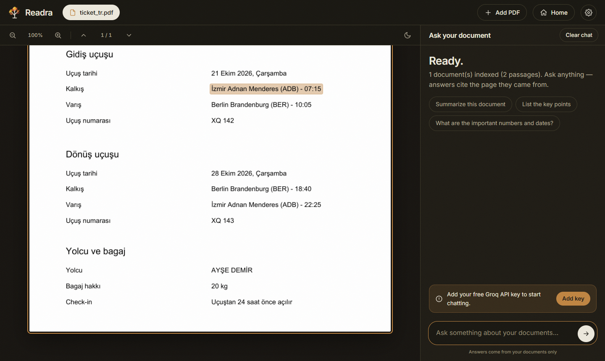

# Readra: chat with your PDFs, and see where each answer comes from

Upload documents, ask in plain language, and get answers that are **checked against the source and highlighted on the exact page**. Built for documents where "probably" is not good enough: contracts, policies, bookings, manuals.

**Live demo:** _add your deployed link here_

<p align="center">
  
  
</p>

_Left: landing page. Right: a Turkish flight booking; the highlighted row is where an answer's evidence quote was found. The booking stores labels and values in separate column streams, which is exactly the layout that makes naive PDF chat tools mix up a payment time and a departure time._

## Why it exists
A flight ticket was uploaded to a typical "chat with PDF" tool and asked *"when is the flight?"*. It answered with the **payment time**. The PDF stored its table column by column, so a plain text dump listed every label first and every value later, and the model had to guess. Readra is built around not letting that happen silently.

## Features
- **Verified answers.** Every answer carries verbatim evidence quotes; the server checks that they exist in the source, that every number, time and date appears in the cited text, and a second pass checks that the quoted *label* matches the question. A mismatch triggers one automatic correction. Each answer shows *Verified*, *Not fully verified* or *Possible mix-up*.
- **Click a citation, see the page.** The PDF viewer jumps to the page and marks the exact sentence or row, on text PDFs and scans alike.
- **Table-aware text extraction** that keeps `Label | Value` together.
- **Scanned PDFs and screenshots-as-PDF.** Image-only pages, or pages whose real content is a picture, are read with OCR (RapidOCR, runs locally).
- **Hybrid retrieval.** Multilingual embeddings + BM25 + a multilingual cross-encoder reranker.
- **Any language in, same language out.** Tested in English, Turkish and German.
- **Multiple documents** with per-document or all-document search, and follow-up questions.
- **Streaming answers** via Groq (Llama 3.3 70B / 3.1 8B); the model list is read live, so model names never go stale.
- **Safe to expose publicly:** per-client rate limits, bounded memory, upload checks, friendly error messages.

## How it works
```
PDF → row-aware text (PyMuPDF; OCR for scans and picture-only content) → 600-char chunks
    → multilingual embeddings (ChromaDB) + BM25 → reciprocal-rank fusion
    → multilingual cross-encoder rerank → top-5 pages (short pages sent whole)
    → Llama 3.3 (Groq): answer + verbatim evidence quotes
    → server checks quotes and values against the source → judge → (self-correction) → UI
```

| Safeguard | What it prevents |
|---|---|
| **Row-aware extraction**: short lines on the same visual row become `Label  \|  Value`. | Labels separated from their values in column-stored tables. |
| **OCR for sparse pages**: pages with little real text, or large pictures, are also OCR'd. | Content that exists only as an image (a browser printout whose body is a picture). |
| **Hybrid retrieval + reranker** | Exact terms (codes, times, names) missed by embeddings alone. |
| **Whole short pages as context** | A value losing its neighbouring labels at a chunk boundary. |
| **Evidence quotes**, verified verbatim | Invented or paraphrased "evidence". |
| **Value check** on numbers, times and dates | Hallucinated figures. |
| **Judge + self-correction** on the quoted label | Mix-ups such as a payment time given as the flight time. |
| **Visible status and clickable quotes** | Silent errors. |

No system is perfect. These layers reduce errors and make the remaining ones visible; they do not prove an answer correct. Check high-stakes values (dates, amounts) against the highlighted source.

## Evaluation
`eval/` holds a 12-page handbook and a one-page Turkish flight booking with 37 labelled questions in English, Turkish and German (5 unanswerable).

| Retrieval (top-5 pages) | Score |
|---|---|
| Page Hit@1 | 100% |
| Page Hit@5 | 100% |
| MRR | 1.00 |
| Page Hit@1, non-English questions | 100% |

Retrieval history on the handbook: embeddings only 90% Hit@1, with BM25 fusion 97%, with the reranker 100%. The set is small and self-built, so read it as a regression suite, not a benchmark.

**Answer-level metrics** (wrong-value rate, verified-quote rate, correct refusals) need a Groq key and are **not quoted here until they have been run**: `GROQ_API_KEY=gsk_... python eval/run_eval.py` writes them to [eval/RESULTS.md](eval/RESULTS.md).

```bash
python eval/run_eval.py          # retrieval metrics (add GROQ_API_KEY for answer metrics)
python eval/test_grounding.py    # 22 tests: evidence parsing, verification, judge and self-correction (scripted model)
python eval/test_server.py       # 19 tests: rate limits, memory cleanup, input checks, error messages
```

## Run locally
```bash
git clone https://github.com/beyzcy/Readra-Chat-With-Your-Pdf.git
cd Readra-Chat-With-Your-Pdf
pip install -r requirements.txt
export GROQ_API_KEY="gsk_..."        # free key: https://console.groq.com/keys (or let visitors enter their own)
uvicorn server:app --reload --port 8000
```
Open http://localhost:8000. The first start downloads the models (embeddings ~0.2 GB, reranker ~0.6 GB, OCR a few MB).

| Environment variable | Default | Meaning |
|---|---|---|
| `GROQ_API_KEY` | none | Optional server-side key. **Leave it unset for a public demo**: the UI then asks each visitor for their own key. |
| `READRA_RERANKER` | `BAAI/bge-reranker-v2-m3-int8` | Cross-encoder model, or `off` to skip it (faster, slightly less accurate). |
| `READRA_RATE` | `1` | Multiplier for all rate limits; `0` disables them. |
| `READRA_MAX_SESSIONS` | `150` | Concurrent sessions kept in memory. |
| `PORT` | `7860` in Docker | Listening port. |

## Deploy (Hugging Face Spaces, Docker)
1. Create a Space, choose **Docker** as the SDK.
2. Push this folder to it. At the top of the Space's `README.md` add:
   ```yaml
   ---
   title: Readra
   sdk: docker
   app_port: 7860
   ---
   ```
3. **Do not add a `GROQ_API_KEY` secret** for a public demo. Without it, every visitor uses their own free Groq key (entered in Settings), so the demo costs you nothing and nobody shares a quota. Only set it for a private deployment you control.
4. The image downloads all models at build time (~0.9 GB), so the first visit is fast.

The same `Dockerfile` works on Render, Railway or Fly.io. Test locally with `docker build -t readra . && docker run -p 7860:7860 -e GROQ_API_KEY=gsk_... readra`.

> The Dockerfile has not been built on the author's machine yet (Docker Desktop was not running); the first build on the host is the real test. Everything it runs was verified outside Docker.

## Limits, privacy and honest caveats
- **Privacy.** Documents are held in memory only, per session, and discarded after an hour of inactivity or when removed. Nothing is stored permanently. Questions and the retrieved passages are sent to Groq to generate an answer, so do not use confidential documents with a hosted demo. A visitor's Groq key stays in their browser tab and is sent with their own requests only; the server does not store it, and a test checks that it never reaches the log.
- **Limits.** 5 files per workspace, 20 MB per file, 40 MB per workspace, OCR on at most 25 pages per file, 20 questions per minute per client.
- **Single process.** Sessions live in memory, so the app runs as one instance. It is a demo-scale design, not a multi-tenant service.
- **OCR** is tuned for upright pages in Latin scripts; very small or low-contrast text can be misread. Verification catches many such cases but cannot make a misread value correct.
- **No accounts, no persistence.** Intentional for a demo.

## Project layout
```
server.py          FastAPI app: API, sessions, rate limits, streaming, verification flow
rag.py             parsing, OCR, hybrid retrieval, reranking, grounding checks, highlighting
static/            landing.html, index.html (app), leaves.js (landing animation), leaves/ (images)
eval/              dataset, retrieval/answer evaluation, sample generators, tests
prefetch_models.py downloads models at image build time
Dockerfile         non-root image, healthcheck, models baked in
```

## Use cases
Company policies and HR handbooks · contracts · bookings and invoices · research papers · product manuals · internal knowledge bases

## Author
**Hatice Beyza Ceyhan**, AI engineer (RAG, LLM apps, computer vision). Available for freelance projects on Upwork.
