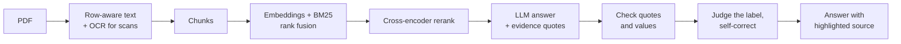

# Readra

**Chat with your PDFs. Every answer is checked against the source and highlighted on the exact page.**


<p align="center">
  
  
</p>

## The problem
Most "chat with PDF" tools sound confident and are sometimes quietly wrong. A flight booking was uploaded to one and asked *"when is the flight?"*; it answered with the **payment time**. The PDF stored its table column by column, so a plain text dump listed every label first and every value later, and the model had to guess which belonged together.

Readra is built so that this kind of error is **prevented where possible and visible where not**.

## What it does
- **Verified answers.** Each answer comes with verbatim evidence quotes. The server checks that they exist in the source, that every number, time and date appears in the cited text, and a second pass checks that the quoted *label* matches the question. A mismatch triggers one automatic correction. Answers are marked *Verified*, *Not fully verified* or *Possible mix-up*.
- **Click a citation, see the page.** The viewer jumps to the page and marks the exact sentence or table row, for text PDFs and scans alike.
- **Table-aware extraction** that keeps `Label | Value` together, and **OCR** for scanned pages and pages whose content is only a picture.
- **Hybrid retrieval** (multilingual embeddings + BM25 + a multilingual cross-encoder reranker) across one or several documents.
- **Any language in, same language out.** Tested in English, Turkish and German.
- **Built to be exposed publicly:** per-client rate limits, bounded memory, upload checks, readable error messages. Visitors use their own Groq key, so it costs nothing to host.

## How it works


| Safeguard | What it prevents |
|---|---|
| Row-aware extraction: short lines on one visual row become `Label \| Value` | Labels separated from their values in column-stored tables |
| OCR for sparse pages and picture-only content | Content that exists only as an image (e.g. a browser printout whose body is a picture) |
| Hybrid retrieval + reranker; whole short pages as context | Exact terms missed by embeddings; a value losing its neighbouring labels |
| Evidence quotes, verified verbatim | Invented or paraphrased "evidence" |
| Value check on numbers, times and dates | Hallucinated figures |
| Judge + self-correction on the quoted label | A payment time given as the flight time |

No system is perfect: these layers reduce errors and expose the remaining ones, they do not prove an answer correct. Check high-stakes values against the highlighted source.

## Evaluation
`eval/` holds a 12-page handbook and a one-page Turkish flight booking (labels and values stored in separate column streams, the failure case above) with 37 labelled questions in English, Turkish and German, 5 of them unanswerable.

| Retrieval, top-5 pages | Score |
|---|---|
| Correct page ranked first (Hit@1) | 100% |
| Correct page in the top 5 (Hit@5) | 100% |
| Mean reciprocal rank | 1.00 |
| Hit@1 on non-English questions | 100% |

On the handbook alone, embeddings-only retrieval reached 90% Hit@1; adding BM25 fusion raised it to 97% and the reranker to 100%. The set is small and self-built, so treat it as a regression suite rather than a benchmark.

```bash
python eval/run_eval.py          # retrieval metrics; add GROQ_API_KEY for answer-level metrics
python eval/test_grounding.py    # 22 tests: evidence parsing, verification, judge, self-correction
python eval/test_server.py       # 39 tests: rate limits, memory cleanup, input checks, key handling
```
Answer-level metrics (wrong-value rate, verified-quote rate, correct refusals) are written to [eval/RESULTS.md](eval/RESULTS.md) when `run_eval.py` runs with a key.

## Quick start

**Docker** (models are baked into the image, about 2.8 GB):
```bash
docker build -t readra .
docker run -p 7860:7860 readra
```
Open http://localhost:7860. The image builds and passes a smoke test (health, pages, OCR sample).

**Python:**
```bash
git clone https://github.com/beyzcy/Readra-Chat-With-Your-Pdf.git
cd Readra-Chat-With-Your-Pdf
pip install -r requirements.txt
uvicorn server:app --port 8000
```
The first start downloads the models (embeddings ~0.2 GB, reranker ~0.6 GB). To ask questions, create a free key at [console.groq.com/keys](https://console.groq.com/keys) and enter it under ⚙ Settings.

<details>
<summary><b>Configuration</b></summary>

| Environment variable | Default | Meaning |
|---|---|---|
| `GROQ_API_KEY` | none | Optional server-side key. **Leave it unset for a public demo**: the UI then asks each visitor for their own key. |
| `READRA_RERANKER` | `BAAI/bge-reranker-v2-m3-int8` | Cross-encoder model, or `off` to skip it (faster, slightly less accurate). |
| `READRA_RATE` | `1` | Multiplier for all rate limits; `0` disables them. |
| `READRA_MAX_SESSIONS` | `150` | Concurrent sessions kept in memory. |
| `PORT` | `7860` in Docker | Listening port. |

</details>

<details>
<summary><b>Deploy to Hugging Face Spaces</b></summary>

1. Create a Space and choose **Docker** as the SDK.
2. Push this repository. Add this block at the top of the Space's `README.md`:
   ```yaml
   ---
   title: Readra
   sdk: docker
   app_port: 7860
   ---
   ```
3. Do **not** add a `GROQ_API_KEY` secret for a public demo; visitors bring their own free key.
4. Models are downloaded at build time, so the first visit is fast.

The same `Dockerfile` works on Render, Railway or Fly.io.
</details>

## Limits and privacy
- Documents are held **in memory only**, per session, and discarded after an hour of inactivity or when removed. Nothing is stored permanently.
- Questions and the retrieved passages are sent to Groq to generate an answer, so do not use confidential documents with a hosted demo. A visitor's Groq key stays in their browser tab; the server does not store it, and a test checks that it never reaches the log.
- Limits: 5 files per workspace, 20 MB per file, 40 MB per workspace, OCR on at most 25 pages per file, 20 questions per minute per client.
- Sessions live in one process: this is a demo-scale design, not a multi-tenant service. There are no accounts and no persistence, by intent.
- OCR is tuned for upright pages in Latin scripts; very small or low-contrast text can be misread. Verification catches many such cases but cannot make a misread value correct.

## Tech stack
| Area | Tools |
|---|---|
| Backend | Python, FastAPI, Uvicorn, streaming responses |
| Retrieval | ChromaDB, BM25, FastEmbed (multilingual MiniLM), BGE reranker v2-m3 (int8) |
| Documents | PyMuPDF, RapidOCR (ONNX Runtime) |
| LLM | Groq API (Llama 3.3 70B, Llama 3.1 8B) |
| Frontend | Vanilla HTML, CSS and JavaScript, no build step; canvas animation |
| Delivery | Docker (non-root, healthcheck, pinned dependencies) |

<details>
<summary><b>Project layout</b></summary>

```
server.py           FastAPI app: API, sessions, rate limits, streaming, verification flow
rag.py              parsing, OCR, hybrid retrieval, reranking, grounding checks, highlighting
static/             landing page, app, leaves.js (animation), leaves/ (images), og-image.png
eval/               dataset, evaluation, sample generators, tests
docs/               screenshots used in this README
prefetch_models.py  downloads models at image build time
requirements.txt    direct dependencies, pinned
constraints.txt     every package pinned (used by the Dockerfile)
Dockerfile          non-root image, healthcheck, models baked in
```
</details>

## What this project demonstrates
Retrieval-augmented generation with hybrid search and reranking · answer verification and self-correction · OCR and layout-aware PDF parsing · retrieval and grounding evaluation with regression tests · a streaming FastAPI service with rate limiting and bounded memory · a custom, responsive front end · reproducible Docker delivery.

## Author
**Hatice Beyza Ceyhan**, AI engineer (RAG, LLM applications, computer vision). Available for freelance projects on Upwork.
